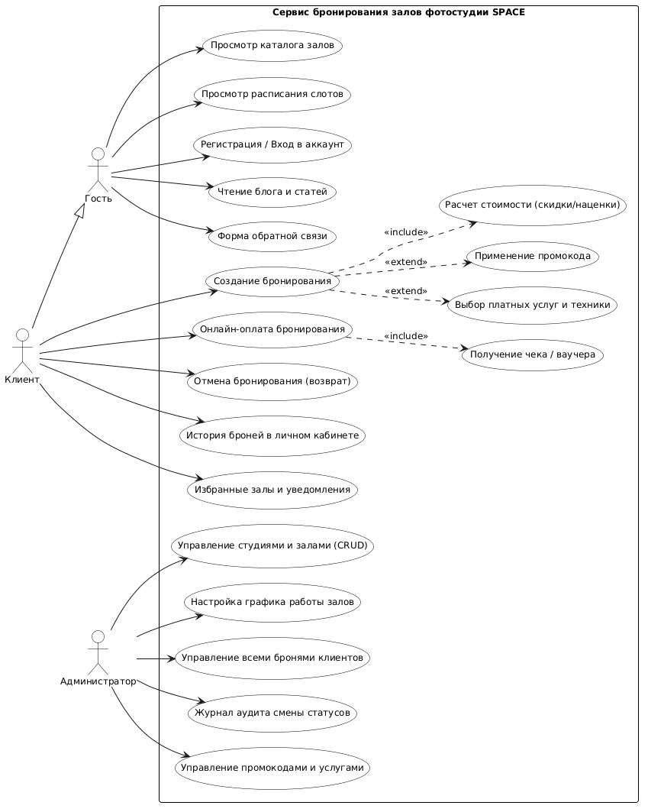
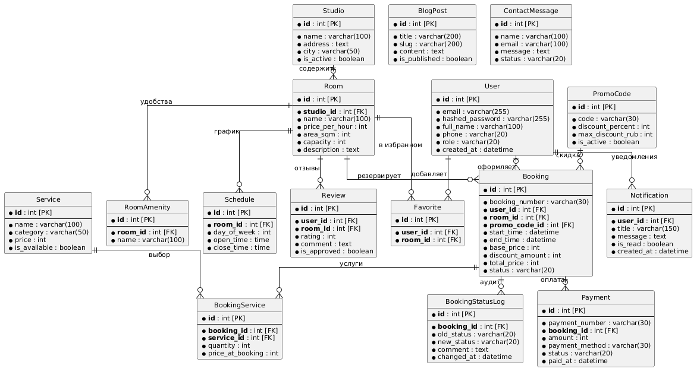

# Онлайн-сервис бронирования залов фотостудии (SPACE)

Проект по дисциплине «Технологии веб-программирования» (Траектория «Юпитер»).

## 1. Команда и роли
- **Backend-разработчик:** Александр — проектирование БД, бизнес-логика слотов, авторизация, REST API на FastAPI.
- **Frontend-разработчик:** Даниэль — клиентский интерфейс, маршрутизация, формы, работа с API на React.

## 2. Предметная область и специфика
Сервис бронирования помещений (залов фотостудии) с почасовой арендой.
- **Динамический расчет свободных слотов на стороне Backend:** сервер анализирует расписание работы зала за вычетом уже существующих подтвержденных броней и отдает фронтенду массив доступных часов.
- **Защита от овербукинга:** исключение пересечения интервалов времени и двойного бронирования на уровне транзакций базы данных.

## 3. Стек технологий
- **Backend:** Python 3.11+, FastAPI, SQLAlchemy 2.0 (async), Alembic, Pydantic v2, bcrypt, PyJWT
- **База данных:** PostgreSQL 16 (Docker)
- **Frontend:** React, Vite, Tailwind CSS

## 4. Архитектура приложения
Трехзвенная архитектура (Клиент — Сервер — База данных):
1. **Frontend (SPA):** пользовательский интерфейс, формы валидации, календарная сетка свободных часов, личный кабинет клиента и администратора.
2. **Backend (FastAPI REST API):** 
   - Модуль аутентификации (JWT, роли `CLIENT` и `ADMIN`);
   - Сервис генерации свободных таймслотов;
   - Валидация броней на отсутствие пересечений интервалов;
   - Защищенный административный интерфейс управления сущностями.
3. **Database (PostgreSQL):** реляционное хранение данных, связи сущностей, транзакционная целостность записей.

### Диаграмма прецедентов (Use Case Diagram)


## 5. Модель данных (16 таблиц, нормализация 3НФ)

### Схема базы данных (ER-диаграмма)

1. **User (`users`):** `id`, `email`, `hashed_password`, `full_name`, `phone`, `role` (CLIENT / ADMIN), `created_at`.
2. **Studio (`studios`):** пространство/комплекс (`id`, `name`, `city`, `address`, `metro`, `phone`, `email`, `description`, `is_active`).
3. **Room (`rooms`):** конкретный зал (`id`, `studio_id` (FK), `name`, `category`, `description`, `price_per_hour`, `capacity`, `area`, `metro`, `address`, `rating`, `reviews_count`, `image_url`, `is_active`).
4. **RoomAmenity (`room_amenities`):** оснащение зала (`id`, `room_id` (FK), `name`).
5. **Schedule (`schedules`):** часы работы по дням недели (`id`, `room_id` (FK), `day_of_week` 0-6, `open_time`, `close_time`).
6. **Service (`services`):** каталог платных доп. услуг (`id`, `name`, `category`, `price`, `is_per_hour`, `description`, `is_active`).
7. **BookingService (`booking_services`):** связующая таблица броней и услуг (`id`, `booking_id` (FK), `service_id` (FK), `quantity`, `price_at_booking`).
8. **PromoCode (`promo_codes`):** система промокодов (`id`, `code`, `discount_percent`, `max_discount`, `max_uses`, `current_uses`, `is_active`).
9. **Booking (`bookings`):** бронирования (`id`, `booking_number`, `user_id` (FK), `room_id` (FK), `promo_code_id` (FK), `start_time`, `end_time`, `status`, `total_price`, `discount_amount`, `additional_services`, `comment`, `contact_name`, `contact_phone`, `created_at`).
10. **Payment (`payments`):** транзакции оплаты (`id`, `payment_number`, `booking_id` (FK), `amount`, `status` [PENDING, PAID, REFUNDED], `payment_method` [CARD, SBP, INVOICE], `transaction_id`, `paid_at`).
11. **BookingStatusLog (`booking_status_logs`):** журнал аудита смены статусов (`id`, `booking_id` (FK), `old_status`, `new_status`, `changed_by_user_id` (FK), `comment`, `created_at`).
12. **Notification (`notifications`):** уведомления клиентов (`id`, `user_id` (FK), `title`, `message`, `type`, `is_read`, `created_at`).
13. **Review (`reviews`):** отзывы к залам (`id`, `room_id` (FK), `author_name`, `rating`, `text`, `created_at`).
14. **Favorite (`favorites`):** избранные залы пользователя (`id`, `user_id` (FK), `room_id` (FK)).
15. **BlogPost (`blog_posts`):** статьи блога (`id`, `title`, `category`, `read_time`, `description`, `image_url`, `is_featured`, `created_at`).
16. **ContactMessage (`contact_messages`):** сообщения формы обратной связи (`id`, `name`, `email`, `topic`, `message`, `created_at`).

## 6. Бизнес-логика бэкенда
- **Динамическое ценообразование:**
  - Коэффициент выходного дня (+15% в субботу и воскресенье).
  - Скидка за длительность (10% при бронировании от 4 часов).
  - Промокоды с ограничением по процентам и максимальной сумме скидки.
- **Политика возврата при отмене бронирования:**
  - Более 24 часов до начала: 100% возврат средств.
  - От 6 до 24 часов: 50% возврат средств.
  - Менее 6 часов: без возврата (штраф 100%).
- **Транзакции и электронные квитанции:**
  - Эндпоинт проведения оплаты `POST /api/bookings/{id}/pay`.
  - Генерация чека/ваучера бронирования `GET /api/bookings/{id}/receipt`.
  - Аудит каждого действия в `booking_status_logs`.

## 7. План функционала по этапам
- **КТ1 (Старт):** предметная область, стек, репозиторий, диаграмма прецедентов, архитектура.
- **КТ2 (Промежуточный результат):** CRUD залов, миграции Alembic, базовая авторизация, скелет админки.
- **КТ3 (Интеграция и Enterprise):** алгоритм проверки слотов, промокоды, платежи, аудит, уведомления, автотесты.

## 8. Запуск автотестов (Pytest)
```powershell
pytest tests -v
```

## 9. Миграции базы данных (Alembic)
```powershell
cd backend
alembic upgrade head
```

## 10. Инструкция по локальному запуску (Quick Start)

### Шаг 1. Запуск базы данных в Docker
Убедитесь, что запущен **Docker Desktop**, затем в корне проекта выполните:
```powershell
docker compose up -d
```
База поднимается на порту **5433** (чтобы не конфликтовать с другими postgres на 5432). Порт можно поменять через переменную `DB_PORT`, а адрес базы для бэкенда — через `DATABASE_URL`.

### Шаг 2. Установка зависимостей бэкенда
```powershell
cd backend
pip install -r requirements.txt
```

### Шаг 3. Первичное наполнение базы данными (залы, расписание, блог, отзывы)
```powershell
python seed.py
```

### Шаг 4. Запуск сервера API
```powershell
python -m uvicorn main:app --reload
```
После запуска сервер доступен по адресу: `http://127.0.0.1:8000`.

### Шаг 5. Интерактивная документация (Swagger UI)
Откройте в браузере:
👉 **[http://127.0.0.1:8000/docs](http://127.0.0.1:8000/docs)**

### Шаг 6. Запуск фронтенда
```powershell
cd frontend
npm install
npm run dev
```
Сайт: `http://localhost:5173`, запросы `/api` проксируются на бэкенд (`127.0.0.1:8000`).

Админ-панель: `http://localhost:5173/admin`. Тестовый администратор создается в `seed.py`: `admin@space.ru` / `admin123`.

---

## 8. Спецификация реализованного REST API

### Аутентификация и профиль (Auth)
- `POST /api/auth/register` — регистрация клиента с хешированием пароля (`bcrypt`) и выдачей JWT.
- `POST /api/auth/login` — авторизация пользователя по email и паролю.
- `GET /api/auth/me` — получение профиля текущего пользователя (Bearer токен).

### Каталог площадок и слоты (Rooms)
- `GET /api/rooms` — список площадок с фильтрацией по категории, поиску, цене, вместимости и авторасчетом свободных слотов на сегодня (`today_available_slots`).
- `GET /api/rooms/{id}` — детальная информация о студии с оборудованием, часами работы и отзывами.
- `GET /api/rooms/{id}/available-slots?date=YYYY-MM-DD` — расчет доступных слотов времени с проверкой расписания и существующих броней.
- `POST /api/rooms` — добавление новой площадки с оборудованием и расписанием (только для ADMIN).

### Бронирования (Bookings)
- `POST /api/bookings` — создание брони с защитой от овербукинга, расчетом доп. услуг и генерацией номера `SP-XXXXXX`.
- `GET /api/bookings/my?tab=upcoming|past|cancelled` — бронирования пользователя для личного кабинета.
- `PATCH /api/bookings/{id}/cancel` — отмена бронирования пользователем.

### Избранное (Favorites)
- `GET /api/favorites` — список избранных площадок пользователя.
- `POST /api/favorites/{room_id}` — добавление студии в избранное.
- `DELETE /api/favorites/{room_id}` — удаление студии из избранного.

### Блог и Контакты
- `GET /api/blog/posts` — статьи блога с фильтром по категориям.
- `POST /api/newsletter/subscribe` — подписка на email-рассылку.
- `POST /api/contact` — отправка формы обратной связи («Напиши нам»).

### Административная панель (Admin)
- `GET /api/admin/bookings` — просмотр всех броней в системе.
- `PATCH /api/admin/bookings/{id}/status` — изменение статуса бронирования (CONFIRMED / CANCELLED / PENDING).
